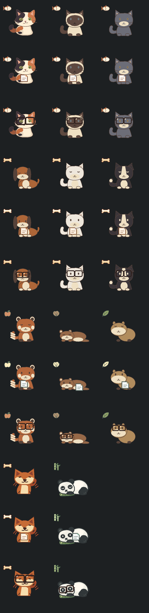
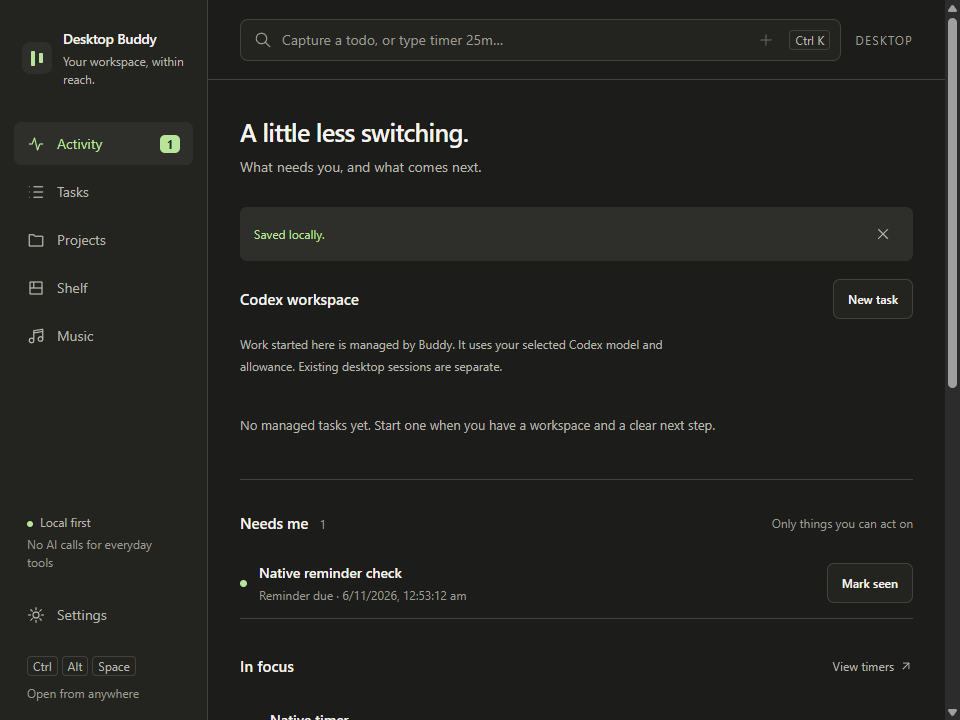
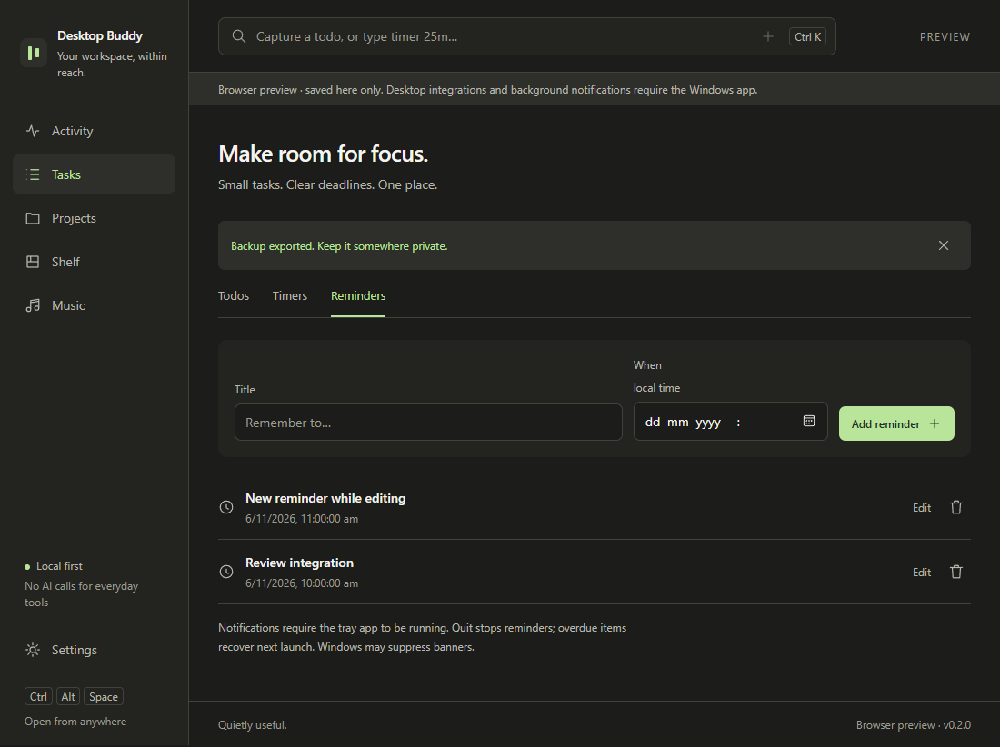

# Desktop Buddy

Desktop Buddy is a Windows desktop pet and quick launcher for files, projects, timers, to-dos, and reminders. It runs from the system tray. You can use the everyday tools without an AI account or an open Codex window.



*Artwork preview rendered by Buddy’s native renderer. Choose from 11 pets with `/pet` or right-click → Choose pet. [Pet tokens, animation behavior, and validation](docs/quiet-pet-family-0.4.md).*

## Get started

1. If you already have a build, run **desktop-buddy.exe**. If you cloned this repository, follow [Build from source](#build-from-source).
2. Click the pet, press **Ctrl+Alt+P** (or **Ctrl+Alt+Space**), or select **Toggle toolbar** from Buddy’s tray menu.
3. Type a question and press Enter for a quick AI answer, or use `/f name` to open the wider file search view. With the input empty, scroll or press **↑/↓** to browse commands. Press **Tab** to fill a command and **Enter** to run it or open the selected result.
4. Click outside or press **Esc** to close the launcher. Use the slash commands below to start a timer or pick a pet.

Quit an older Buddy instance from its tray menu before launching a newer executable. The development build is unsigned. The detailed tools window requires the Microsoft Edge WebView2 Runtime.

## Quick commands

| Type | What it does |
| --- | --- |
| `/f lecture notes` | Search for matching files and folders |
| `/t 25m review notes` | Start a 25-minute focus timer |
| `/d send draft` | Add a to-do |
| `/r 10m stretch` | Set a reminder for 10 minutes from now |
| `/w my project` | Find a saved workspace and open it in Cursor or Explorer |
| `/pet` | Choose a pet and apply its launcher theme |
| `/tools` | Open the detailed tools window |
| `/copy` | Copy the file references currently held by the pet |

Timer and reminder commands accept 1–1440 whole minutes. The pet shows the remaining time for a running or paused timer. Click the countdown to pause or resume. A small paw appears when you have open to-dos or a scheduled reminder, with a pending to-do count capped at 9+. Click it to see up to eight open to-dos, choose a task, then select **Mark complete**. **Open tools** opens the detailed panel. The paw brightens when a reminder is due. `/tools` and `/copy` are available when typed directly. Search shows the matching name, type, and location. It covers connected Windows drive roots and other configured roots within a bounded scan. Results can be partial.

## Hand off files

Drop up to 20 local files or folders onto the pet. The pet holds their references until you clear them or complete a handoff. Drag the loaded pet to a compatible folder or app to request a copy, or use `/copy` and paste. Hold **Alt** while dragging to move the pet itself.

A successful handoff clears the pet’s hold. A cancelled drag leaves them held. Clearing and quitting discard Buddy’s references. Your source files stay in place.

The pet’s right-click menu, paw list, tray options, and launcher text-edit menu follow the selected pet’s colors and font. Choose a pet or try a motion set from the right-click menu. Windows high-contrast settings use the system menu appearance.

Choose **Try and select motion set** from the tray menu to preview one of five file handoff styles without transferring a file. Buddy also reacts when the launcher opens, focus changes, a to-do is saved or checked off, a reminder comes due, or a managed Codex task changes state. Panda opens its eyes when you open the launcher or it holds a file. Buddy follows the Windows animation setting.

## Manage work and reminders

Type `/tools` for **Activity**, **Tasks**, **Projects**, **Shelf**, **Music**, and **Settings**. Use **Projects** to save folders and resume notes, **Tasks** to edit to-dos, timers, and reminders, and **Settings** to export or import a JSON backup. Music includes a manual LRC lyrics reader.



*Windows build screenshot of the detailed Activity window. The compact pet launcher is a separate surface.*

<details>
<summary>See the Reminders view</summary>



*Browser preview screenshot. Windows notifications require the desktop app.*

</details>

## Optional Codex tasks

With the native Codex CLI installed and signed in, open **Activity → New task**, select a saved project and model, and submit a prompt. Tasks start with read-only access unless you explicitly select workspace write. Command approvals and questions are handled in Buddy. After the task completes, choose **End connection** to release its runtime.

Save reusable notes in **Projects**. In **New task → Project memory and file references**, you can include that note, an excerpt from one completed task in the same project, and up to eight files inside the workspace. Enter file paths or select them from the Shelf. Codex may send the selected context and any file contents it reads to its service.

Use **Activity → Pick up a project**, or type `/resume` in the launcher, to return to a project. Save your next step, pin Shelf references, link existing open to-dos, and view the latest dated Codex task. **View task details** opens its local receipt. Project notes, references, and linked to-dos persist in Buddy’s local database.

For a question about a menu or notes, open **Activity → Ask about files**. Pick the saved project and a model, then enter your question and add the files inside that project. You can reuse paths saved on the Shelf. Buddy starts the question in a read-only workspace and asks Codex to cite the source. Open the task’s **Completion receipt** to read the answer.

Buddy stores task records locally. An active task interrupted by a restart requires checking its state before retrying. Existing Codex sessions can be discovered as stored history. Screen guidance and Claude or Antigravity connections are planned features.

## Local data and notifications

Buddy keeps tasks, timers, reminders, projects, preferences, and agent receipts in `buddy.sqlite3` in the app’s local data folder. Settings shows the location. Backups contain plaintext records. Keep Buddy running in the tray for reminders. If you quit, overdue reminders are recovered when you next launch it. Windows can suppress notification banners, and reminders are also visible in **Needs me**.

## Build from source

On Windows, install Node.js 22+, stable Rust with the MSVC toolchain, Visual Studio C++ Build Tools, and WebView2. From the repository root in PowerShell:

```powershell
npm ci
.\scripts\build.ps1
```

With the default Cargo output directory, run `src-tauri\target\release\desktop-buddy.exe`. The build script checks for fresh frontend assets and a rebuilt executable, then prints its path and SHA-256 checksum. Pass `-OutputDirectory C:\path\to\release` to copy the standalone executable into a release folder.

```powershell
npm run dev
npm test
cargo test --release --manifest-path src-tauri/Cargo.toml -j 2
```

`npm run dev` starts the browser preview server. Open the local URL it prints. Preview data is separate from the native app. For native troubleshooting, launch the executable with `--commands` to toggle the launcher, `--panel` to open the full tools window, or `--tray` to start in the tray. See the [0.4 build report](docs/build-report-0.4.md) for historical verification details.


## Screen helper

Type `/exp your question` to capture the current display after a brief focus-settle delay and answer your question in a speech bubble beside Kitty, with loading dots and nerdy glasses. The tools window stays closed. Type `/sc your question` to fill one supported accessible text field or select a radio/checkbox quiz option. Keep the intended app in front when invoking the command. No suitable control means Kitty gives an attention animation and changes nothing. Submit buttons and password fields are excluded. Custom canvas controls may not expose the Windows accessibility support required for filling.

Plain text asks your signed-in Codex account for a quick answer. The command picker suggests 10 everyday actions; `/tools` opens management/settings. `/codex` lists recent local chats. Source-reported running/idle states and explicit follow-ups require a live shared app-server connection; this desktop installation did not expose that connection during verification, so Kitty displays unavailable status and disables sending. See [speech-bubble behavior, connection and limits](docs/kitty-bubbles-0.4.md).


## Quick AI answers

Plain text in the native pet command bar now asks your signed-in Codex AI when you press Enter. Replies appear in a small window beside the pet. Use `/d task` for Todos and `/f name` for file search. See [connection behavior and checks](docs/quick-answers-and-pet-polish-0.4.md).


### Current release: quiet screen commands

`/sc` closes the command bar on the first Enter and works silently, using only Kitty’s animations for feedback. `/exp question` returns a short answer in the pet bubble without connection/provider chatter. Command captures wait 100 ms for focus to settle; `/exp` skips control scanning. Manual capture/review retains its three-second countdown. Eight everyday commands remain: `/sc`, `/exp`, `/t`, `/r`, `/d`, `/todos`, `/f`, `/tools`.

Codex chats and workspace/project features are archived and inaccessible in this release; their implementations and saved data are kept for later. This supersedes older feature descriptions above. Screen explanations and quick answers still use the signed-in Codex CLI. See [release behavior and verification](docs/silent-screen-and-archived-features-0.4.md).


### Compact answers and follow-ups

Answer bubbles now fit short replies and stay small for long replies, with a themed scrollbar and fixed header/follow-up controls. Outside clicks or Escape dismiss the bubble. Kitty animates during loading; the bubble appears only after an answer is ready. Type a follow-up at the bottom to continue from the previous answer and, for /exp, the original capture while it remains current. See [behavior and verification](docs/compact-answer-followups-0.4.md).


### Faster default explanations

`/exp` now uses a lightweight screen-reading profile on GPT-6 Luna for shorter turnaround, while `/sc` and explicitly selected models keep their prior behavior. The answer scrollbar is a 4-pixel square-edged bar using the current theme accent. See [measurements and behavior](docs/fast-exp-0.4.md).
