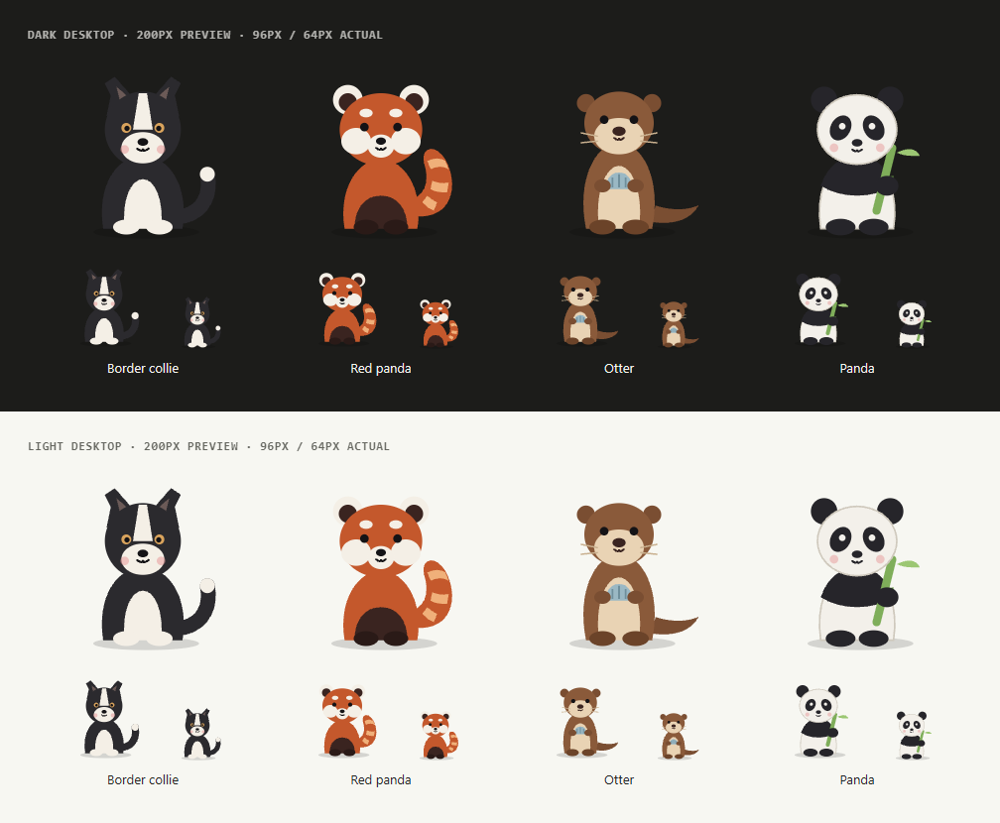

# Pet style suggestions: Border collie, Red panda, Otter, Panda

Nothing here ships yet. `pet_reference.rs` only renders approved artwork, so a style becomes
real only after it is picked.

## Option 1: "Pebble" vector style



- Flat fills, no outlines, three or four tones per animal, a soft ground shadow.
- Source: [pebble-style.html](pebble-style.html), one SVG `<symbol>` per pet on a 120×120 grid.
- Trade-off: crisp at every DPI and tiny (about 1–2 KB per pet instead of about 1.1 MB per
  PNG), but it is a new look next to the detailed reference pets. To ship it, each symbol is
  ported to the native GDI renderer the same way Shiba and Panda already are.

## Option 2: new PNGs from an image generator

Keep the current look and replace the files. Generate each image at **1254×1254, transparent
background, the animal centred and filling about 40% of the canvas, sitting and facing the
viewer**. Use the same shared style line for all four so they match:

> Shared style: cute chibi desktop pet, soft cel shading, thin warm-brown outline, rounded
> shapes, small dark eyes with one highlight, gentle blush, muted natural colours, no text, no
> background, no ground, no props except the one named.

| Pet | Prompt (append the shared style) | File |
|---|---|---|
| Border collie | A black-and-white border collie puppy sitting upright, white blaze down the face and a white chest, one ear folded at the tip, amber eyes, a fluffy tail with a white tip. | `collie.png` |
| Red panda | A red panda sitting upright, rust-orange coat, dark brown legs and belly, white ear rims, white cheeks and eyebrow spots, a thick tail with pale rings curled around one side. | `red-panda.png` |
| Otter | A river otter sitting upright on its tail, warm brown fur, cream face and chest, short round ears, small whiskers, holding a pale blue clam against its chest. | `otter.png` |
| Panda | A giant panda cub sitting upright, white body, black ears, arms, legs and tilted eye patches, holding a short green bamboo stalk with one leaf. | `panda.png` (new; Panda is vector art today) |

To use one, drop the PNG into `assets/pet-reference/` under the file name above and update its
`sha256` and `bytes` in `manifest.json`:

```powershell
Get-FileHash assets\pet-reference\collie.png -Algorithm SHA256; (Get-Item assets\pet-reference\collie.png).Length
```
