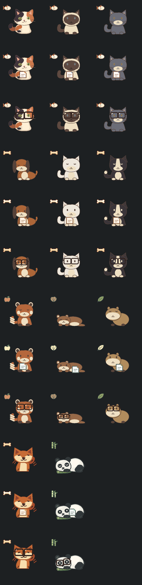

# Quiet pet family — 0.4

Choose a pet using `/pet` (arrow keys or mouse wheel to browse) or **right-click → Choose pet**. The selection persists and themes the launcher, menus, and tool accents.

The simple native lineup has 11 choices: Calico, Siamese, blue shorthair, Dachshund, Samoyed, Border collie, red panda, otter, capybara, Shiba Inu, and Panda. The existing Calico, Shiba, and Panda remain available.

Todo controls are borderless and retain the same checklist action: cats have fish, dogs have bones, red panda has an apple, otter has a clam, capybara has a leaf, and Panda has bamboo.

The new art uses flat GDI geometry with coat-specific silhouettes and markings. It shares the existing bounded animation states for file pickup, holding, and handoff. Context reactions reuse the existing launcher, focus, Todo, reminder, and AI events: cat ears perk, dogs wag on completion, red panda moves its tail, and otter/capybara use gentler movement. Square glasses are anchored to each face while thinking or explaining. File overlays sit over the body of resting pets.

Quiet mode and Windows animation preferences still govern motion. This adds no background animation loop, external image downloads, sprite atlas, or dependency. No AI call is needed to change a pet or open Todo. File transfers and screen commands keep their existing behavior.

Preview order: cats; new dogs; red panda/otter/capybara; original Shiba/Panda. Each group has three rows: idle, holding, glasses. This is an offscreen render by the actual Windows GDI renderer, not an illustration mockup.

Validation: 75 native tests passed (two deliberate live-inference probes ignored); eight TypeScript tests and 19 headless UI tests passed (four archived-flow tests skipped). Native coverage includes every selectable pet rendered in all three states and appearance-key/token/context compatibility. Frontend production build passed. The packaged release embeds the frontend through Tauri.

CS learning: share the state machine, specialize the renderer. `Appearance::family()` selects a reusable animation/palette family, while `context_pose()` and the pet geometry own species details. One catalogue feeds both pet choosers so their ordering and available choices cannot drift. To practice, trace a Todo-completed event from the existing cue to a dog's tail reaction in `src-tauri/src/pet_quiet.rs`.
