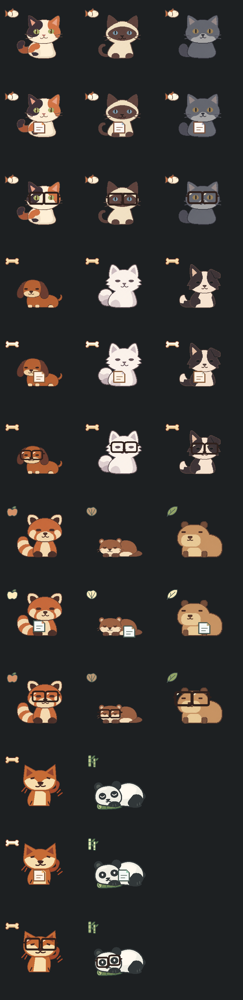

# Quiet pet family — 0.4

Choose a pet using `/pet` (arrow keys or mouse wheel to browse) or **right-click → Choose pet**. The selection persists and themes the launcher, menus, and tool accents.

The simple native lineup has 7 choices: Calico, Dachshund, Samoyed, Border collie, otter, capybara and Shiba Inu. Siamese, Blue shorthair and Red panda were removed; Panda is no longer offered but stays as the internal colour and animation family for otter and capybara.

Todo controls are borderless and retain the same checklist action: cats have fish, dogs have bones, otter has a clam and capybara has a leaf.

The Border collie's eyes were recoloured (amber iris, dark pupil, one glint) because the original near-black eyes vanished against the dark coat at pet size.

The nine approved preview PNGs are embedded unchanged in `assets/pet-reference/`. Their file hashes are recorded in `manifest.json`. The renderer omits only the connected dark presentation background, crops the retained artwork, and keeps its original aspect ratio, silhouette, face, colors, and coat details. It does not recreate the characters from circles and paths. The existing Shiba and Panda remain vector art.

The shared bounded animation states still supply context-specific whole-pet lean, bounce, file pickup, holding and handoff. The original facial expressions stay intact. Square glasses are mapped from the artwork's eye anchors while thinking or explaining; file overlays stay over the body. Quiet mode and Windows animation preferences still govern motion. There is no additional idle animation loop or network fetch.

Each selected reference is decoded once and its cropped pixels are cached. Automated checks cap the total for all nine decoded crops at 8 MiB; the large presentation canvases are discarded after decoding. Original PNGs increase the packaged executable size. This replaces the earlier approximate GDI shapes after a visual fidelity correction.

Preview order: cats; new dogs; red panda/otter/capybara; original Shiba/Panda. Each group has three rows: idle, holding, glasses. This is an offscreen render by the actual Windows GDI renderer, not an illustration mockup.

Validation: 76 native tests passed (two deliberate live-inference probes ignored); the previous unchanged frontend passed eight TypeScript tests and 19 headless UI tests (four archived-flow tests skipped). Native coverage includes every selectable pet rendered in all three states and appearance-key/token/context compatibility. Frontend production build passed. The packaged release embeds the frontend through Tauri.

CS learning: share the state machine, specialize the renderer. `Appearance::family()` selects a reusable animation/palette family, while `context_pose()` and the approved artwork own species details. One catalogue feeds both pet choosers so their ordering and available choices cannot drift. To practice, trace a Todo-completed event from the existing cue to a dog's completion reaction in `src-tauri/src/pet_quiet.rs`.

Update (24 November 2026): Siamese and blue shorthair were removed at Dharu's request. A saved selection of either falls back to Calico. Their reference PNGs are no longer embedded, which reduces the executable by about 2.3 MB.
